# Cisco Packet Tracer Labs: Router & Switch Configuration

Three network installation labs built and tested in **Cisco Packet Tracer** on Cisco ISR routers, Catalyst switches and a Linksys wireless router. They cover IPv4/IPv6 addressing, SSH hardening, static and summarised routing, a backup (floating) default route, and a WPA2 wireless LAN. The routers and switches are configured from the IOS command line, and the wireless router through its web GUI.

Completed for *ICTTEN312 Install telecommunications network equipment* (Labs 1–2) and *UEEDV0010 Select and arrange equipment for wireless communication networks* (Lab 3), Advanced Diploma of Electronics and Communications Engineering, RMIT, 2026.

| Lab | Topics | Packet Tracer file |
|---|---|---|
| [1. Router setup, SSH and IPv6](#lab-1-router-setup-ssh-and-ipv6) | Dual-stack addressing, password policy, SSH-only VTY access, IPv6 routing | [`lab1-ssh-ipv6.pkt`](lab1-router-ssh-ipv6/lab1-ssh-ipv6.pkt) |
| [2. Static and floating routes](#lab-2-static-and-floating-static-routes) | Static routes, default routes, floating static backup route, traceroute | [`lab2-static-routing.pkt`](lab2-static-floating-routes/lab2-static-routing.pkt) |
| [3. Wireless campus-to-ISP network](#lab-3-wireless-campus-to-isp-network) | WRT300N wireless router, WPA2-AES, DHCP, summarised static route, ISP link design | [`lab3-wireless-network.pkt`](lab3-wireless-network/lab3-wireless-network.pkt) |

Open the `.pkt` files in Cisco Packet Tracer 8.x.

---

## Lab 1: Router setup, SSH and IPv6


### Addressing

| Device | Interface | IPv4 | IPv6 | Link-local |
|---|---|---|---|---|
| R1 | G0/0/0 | 192.168.0.1/24 | 2001:db8:acad::1/64 | fe80::1 |
| R1 | G0/0/1 | 192.168.1.1/24 | 2001:db8:acad:1::1/64 | fe80::1 |
| R1 | Loopback0 | 10.0.0.1/24 | 2001:db8:acad:2::1/64 | fe80::1 |
| PC-A | NIC | 192.168.1.10/24 (gw .1) | 2001:db8:acad:1::10/64 | gw fe80::1 |
| PC-B | NIC | 192.168.0.10/24 (gw .1) | 2001:db8:acad::10/64 | gw fe80::1 |

### What I configured on R1

- Hostname, `no ip domain-lookup`, and `service password-encryption`.
- `security passwords min-length 12`.
- A local user `SSHadmin` with an encrypted secret, and a 1024-bit RSA key for SSH.
- VTY lines 0–4 set to `login local` and `transport input ssh` (SSH only, no Telnet), with `exec-timeout 4 0` to log idle sessions out after 4 minutes.
- `ipv6 unicast-routing`.
- IPv4, IPv6 global and IPv6 link-local addresses on all three interfaces, with descriptions.
- Configuration saved to startup-config.
- On S1: hostname, and configuration saved.

| VTY / SSH config | Interfaces up |
|---|---|
| 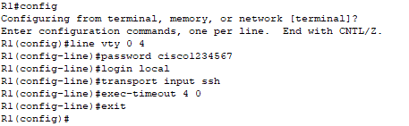 | 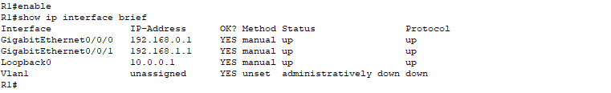 |

### Verification

- **Ping:** PC-A → PC-B across the router, 4/4 replies, 0% loss.
- **SSH:** PC-A logged in to R1 at 192.168.1.1 as `SSHadmin`.
- **`show version`:** ISR 4300, IOS XE 03.16.05.S. I used it to find the system image file and the model.

| Ping PC-A → PC-B | SSH from PC-A |
|---|---|
| 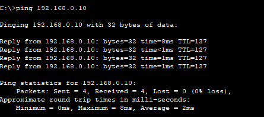 | 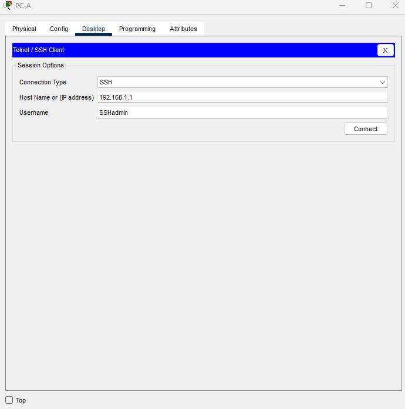 |

---

## Lab 2: Static and floating static routes

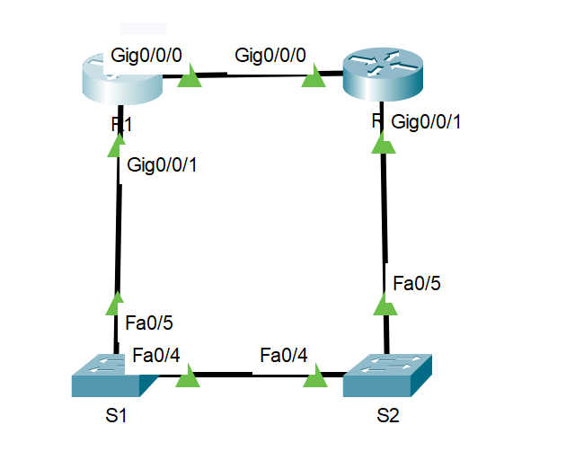

### Addressing

| Device | Interface | IPv4 |
|---|---|---|
| R1 | G0/0/0 | 172.16.1.1/24 |
| R1 | G0/0/1 | 192.168.1.1/24 |
| R1 | Loopback1 | 10.1.0.1/24 |
| R1 | Loopback2 | 209.165.200.225/27 |
| R2 | G0/0/0 | 172.16.1.2/24 |
| R2 | G0/0/1 | 192.168.1.2/24 |
| R2 | Loopback1 | 10.2.0.1/24 |
| R2 | Loopback2 | 209.165.200.193/27 |

The two routers are joined directly on G0/0/0, and through switches S1 and S2 on G0/0/1. That gives two paths between them.

### Routes configured

```
! R1: static route to R2's Loopback1, via the switched link
ip route 10.2.0.0 255.255.255.0 192.168.1.2

! R1: floating static default route via the switched link (AD 5 = backup)
ip route 0.0.0.0 0.0.0.0 192.168.1.2 5

! R2: default route back to R1
ip route 0.0.0.0 0.0.0.0 172.16.1.1
```

A **floating static route** has a higher administrative distance (5 here) than a normal static route (1). It stays out of the routing table until the main route fails, so it acts as a backup path.

### Verification

| `show ip route` on R1 | `traceroute 10.2.0.1` |
|---|---|
| 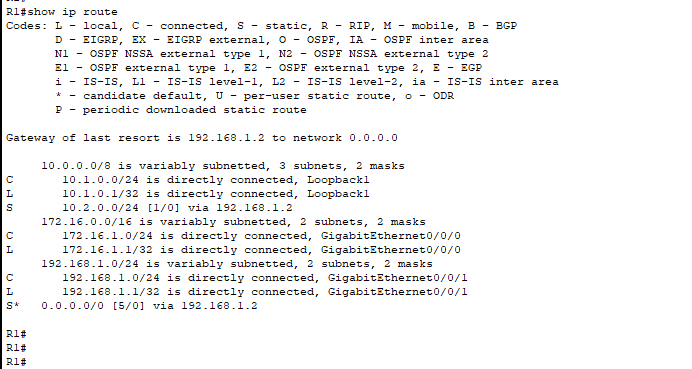 | 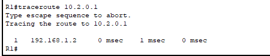 |

R1's routing table shows the connected networks, the static route to `10.2.0.0/24` via 192.168.1.2, and a default route. `traceroute 10.2.0.1` goes through **192.168.1.2** in one hop, as required.

---

## Lab 3: Wireless campus-to-ISP network

A campus network (RMIT) with wired hosts and a wireless LAN, connected through two Cisco 2911 routers to an ISP network (Telstra).

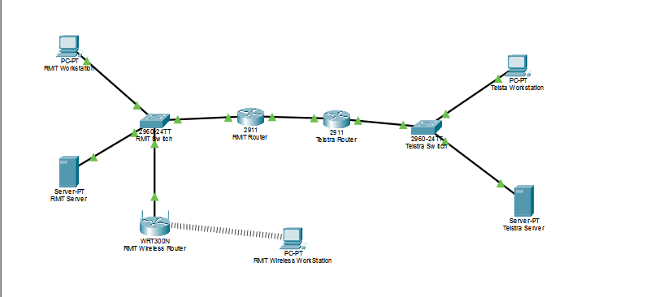

### Addressing

| Device | Interface | IPv4 | Gateway |
|---|---|---|---|
| Telstra router | G0/1 / G0/0 | 20.20.20.1 / 10.10.10.1 | – |
| RMIT router | G0/1 / G0/0 | 192.168.1.1 / 10.10.10.2 | – |
| RMIT wireless router (WRT300N) | Internet / LAN | 192.168.1.4 / 192.168.2.1 | 192.168.1.1 |
| Telstra workstation / server | NIC | 20.20.20.2 / 20.20.20.3 | 20.20.20.1 |
| RMIT workstation / server | NIC | 192.168.1.2 / 192.168.1.3 | 192.168.1.1 |
| RMIT wireless workstation | NIC | DHCP from the WRT300N | – |

All subnets are /24.

### What I configured

- **Both 2911 routers:** hostnames (`Telstra_Router`, `RMIT_Router`), `no ip domain-lookup`, and interface addressing.
- **WRT300N wireless router (web GUI):** SSID `RMIT Wireless Router`, WAN and LAN addressing, DHCP for wireless clients, and **WPA2-Personal with AES** encryption.
- **Routing:**

```
! Telstra: one summarised route covers both RMIT networks (192.168.1.0 and 192.168.2.0)
ip route 192.168.0.0 255.255.252.0 10.10.10.2

! RMIT: default route towards the ISP
ip route 0.0.0.0 0.0.0.0 10.10.10.1
```

The `/22` summary (192.168.0.0–192.168.3.255) covers the wired LAN and the wireless LAN in a single route on the ISP router.

| Wireless SSID | WPA2-AES security |
|---|---|
| 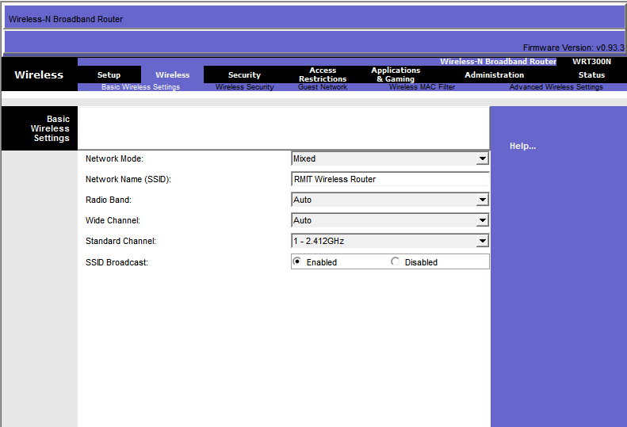 | 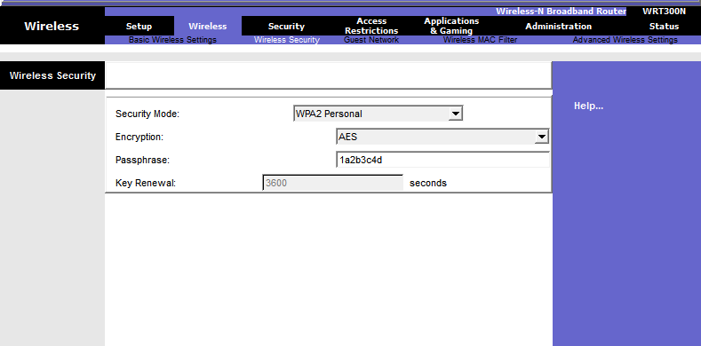 |

### Verification

I sent pings from the **wireless workstation** to the wireless router's LAN interface, to the RMIT router's G0/1, and across both routers to the **Telstra server (20.20.20.3)**. All three had 0% loss.

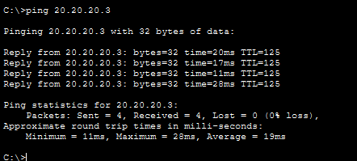

### Design decisions

- **Router–ISP link (5 km):** single-mode fibre. Its 9 µm core carries one light path, so it doesn't suffer the modal distortion that limits copper and multimode fibre over that distance.
- **Switch to wireless router:** Cat 5 cable through the ceiling on J-hooks and down a service pole to the middle of the room. That keeps it inside the 100 m Ethernet limit and off the floor, so it's not a trip hazard.
- **Rack earthing:** gives fault current and static a safe path to ground. That protects people from shock and the equipment from surges.
- **Wireless router comparison:** the Cisco WRT300N is 802.11n, 2.4 GHz only, with Fast Ethernet ports. The TP-Link Archer AX12 is Wi-Fi 6, dual-band (5 GHz), with WPA3 and gigabit ports, so it's better suited to a modern deployment.

---

## Skills shown

- Building a topology from a plan, with correct cabling between routers, switches and PCs.
- Cisco IOS CLI: interface configuration, IPv4 and IPv6 dual-stack, saving configs.
- Device hardening: password policy, encrypted passwords, SSH-only remote access, idle timeouts.
- Static, default, summarised and floating static routing, and administrative distance.
- Wireless LAN setup: SSID, DHCP, WPA2-AES security, and choosing equipment and cabling (single-mode fibre, Cat 5 limits).
- Checking the network with `show ip route`, `show ip interface brief`, `show version`, ping, traceroute and SSH.
- Working to WHS requirements for network installation: hazard identification, ESD control, cable management.
